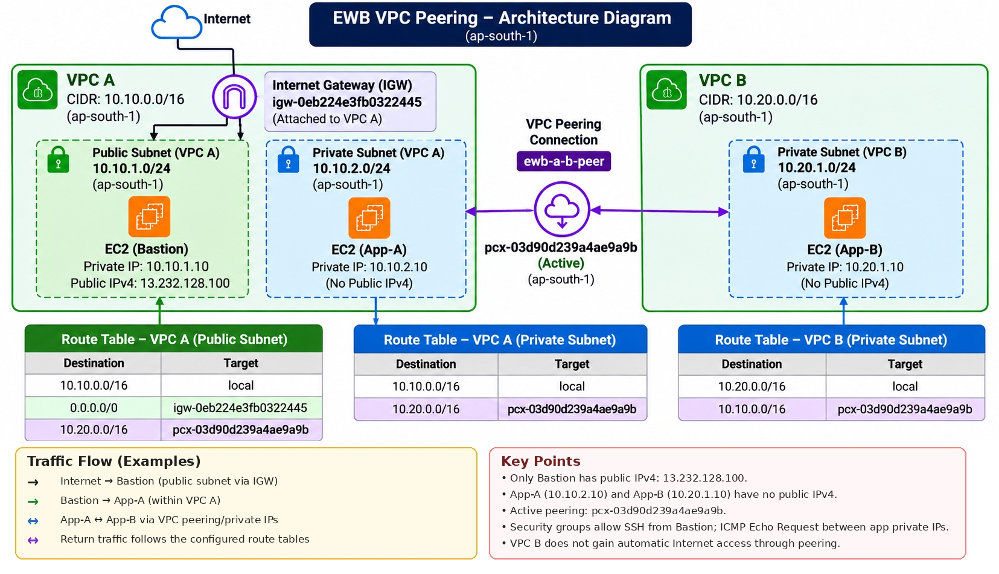

# AWS VPC Peering — Secure Private Cross-VPC Communication

A hands-on AWS networking project completed as part of the **AWS Cloud Computing Internship with EWB Edutech Pvt. Ltd.** The lab demonstrates private IPv4 connectivity between two non-overlapping Amazon Virtual Private Clouds (VPCs) using VPC Peering, explicit route-table configuration, restrictive security groups, and bastion-based SSH access.

> **Project status:** Connectivity was validated during the lab. The three project EC2 instances were subsequently terminated, and the project VPCs were removed. This repository documents the configuration and results recorded during testing; it is **not a live deployment** and does not automatically recreate AWS resources.

## Table of Contents

- [Project Information](#project-information)
- [Objectives](#objectives)
- [Architecture](#architecture)
- [Network Design](#network-design)
- [AWS Resource Inventory](#aws-resource-inventory)
- [Routing Configuration](#routing-configuration)
- [Security Configuration](#security-configuration)
- [SSH Access Through the Bastion](#ssh-access-through-the-bastion)
- [Testing and Results](#testing-and-results)
- [Baseline Evidence Disclosure](#baseline-evidence-disclosure)
- [Key Networking Concepts](#key-networking-concepts)
- [Evidence Index](#evidence-index)
- [Cleanup and Cost Considerations](#cleanup-and-cost-considerations)
- [Repository Structure](#repository-structure)
- [Reproducing the Lab](#reproducing-the-lab)
- [Viva Questions and Answers](#viva-questions-and-answers)
- [Learning Outcomes](#learning-outcomes)
- [Author](#author)

---

## Project Information

| Field | Details |
|---|---|
| Student | Tanay Jain |
| College | Birla Institute of Technology, Mesra — Jaipur Campus |
| Internship | AWS Cloud Computing Internship |
| Organization | EWB Edutech Pvt. Ltd. |
| AWS Region | Asia Pacific (Mumbai), `ap-south-1` |
| Availability Zone | `ap-south-1a` |
| Completion date | 19 October 2026 |
| Main AWS services | Amazon VPC, Amazon EC2, VPC Peering, Internet Gateway, route tables, security groups |
| Evidence | 22 screenshots documenting configuration, tests, and cleanup |

## Objectives

The lab was designed to demonstrate how two independent VPCs can communicate privately through VPC Peering.

The objectives were to:

1. Design two VPCs with non-overlapping IPv4 CIDR blocks.
2. Create public and private subnets according to the lab architecture.
3. Deploy a public bastion host and two private application instances.
4. Attach an Internet Gateway to VPC A for eligible public-subnet traffic.
5. Establish a VPC Peering connection between VPC A and VPC B.
6. Configure the necessary routes in all three route tables.
7. Restrict administrative access with security-group rules.
8. Connect to private instances using OpenSSH `ProxyJump`.
9. Test ICMP Echo Request connectivity in both directions.
10. Demonstrate a controlled connectivity failure by temporarily removing an ICMP security-group rule, then restore the rule and verify recovery.
11. Record evidence and clean up project resources after testing.

---

## Architecture



*Figure 1. Architecture during validation, showing the VPCs, subnets, EC2 instances, Internet Gateway, VPC Peering connection, and routing design.*

### Traffic flows

**Administrative access**

`Administrator workstation → Bastion public IPv4 → Bastion private IP → App-A or App-B`

**Private application communication**

`App-A (10.10.2.10) ↔ VPC Peering ↔ App-B (10.20.1.10)`

App-A and App-B were configured without public IPv4 addresses. Administrative SSH access to those private instances was routed through the bastion.

> The diagram represents the lab configuration at test time. The resources were subsequently removed; the diagram does not mean the environment is still running.

## Network Design

The VPCs use non-overlapping address ranges, which allows their address spaces to be routed through a VPC Peering connection.

### VPC A — `ewb-vpc-a`

| Property | Value |
|---|---|
| VPC CIDR | `10.10.0.0/16` |
| Public subnet | `ewb-a-public` — `10.10.1.0/24` |
| Private subnet | `ewb-a-private` — `10.10.2.0/24` |
| Internet Gateway | `ewb-igw-a` |
| Internet Gateway ID | `igw-0eb224e3fb0322445` |

VPC A contains the public bastion host and App-A in a private subnet. Its public route table has the local route, an Internet Gateway default route, and a route to VPC B through the peering connection.

### VPC B — `ewb-vpc-b`

| Property | Value |
|---|---|
| VPC CIDR | `10.20.0.0/16` |
| Private subnet | `ewb-b-private` — `10.20.1.0/24` |
| Internet Gateway | None configured for this project |

VPC B contains App-B in a private subnet. Its route table has the local route and a route to VPC A through the peering connection.

---

## AWS Resource Inventory

The identifiers below are historical identifiers recorded during testing. They are included for traceability; they do not indicate that the resources remain active.

### VPCs and subnets

| Resource | Name | AWS identifier | CIDR |
|---|---|---|---|
| VPC A | `ewb-vpc-a` | `vpc-0a6ce73ff02b1503f` | `10.10.0.0/16` |
| VPC B | `ewb-vpc-b` | `vpc-075df51206347c58f` | `10.20.0.0/16` |
| Public subnet A | `ewb-a-public` | `subnet-0484e07086d26edb5` | `10.10.1.0/24` |
| Private subnet A | `ewb-a-private` | `subnet-0d7771459ff9a714d` | `10.10.2.0/24` |
| Private subnet B | `ewb-b-private` | `subnet-0b71be209ac84f3f3` | `10.20.1.0/24` |

### Route tables

| Resource | Name | AWS identifier |
|---|---|---|
| Public route table A | `ewb-rt-a-public` | `rtb-07eb6affd6f3a0e73` |
| Private route table A | `ewb-rt-a-private` | `rtb-0e0dde41748dfa436` |
| Private route table B | `ewb-rt-b-private` | `rtb-0dfff1ec80beab2f9` |

### Internet Gateway and VPC Peering

| Resource | Name | AWS identifier | State during testing |
|---|---|---|---|
| Internet Gateway | `ewb-igw-a` | `igw-0eb224e3fb0322445` | Attached |
| VPC Peering connection | `ewb-a-b-peer` | `pcx-03d90d239a4ae9a9b` | Active |

### Security groups

| Resource | Name | AWS identifier |
|---|---|---|
| Bastion security group | `ewb-sg-bastion` | `sg-0dd786e889c8dc6c9` |
| App-A security group | `ewb-sg-app-a` | `sg-06ebed5e7197ab5d5` |
| App-B security group | `ewb-sg-app-b` | `sg-0ef25547ef3d026e5` |

### EC2 instances

All three instances used instance type `t3.micro` in Availability Zone `ap-south-1a`.

| Instance | Instance ID | Private IPv4 | Public IPv4 during testing |
|---|---|---|---|
| `ewb-bastion` | `i-0a96fe6409821ab86` | `10.10.1.10` | `13.232.128.100` |
| `ewb-app-a` | `i-07875dafbce902beb` | `10.10.2.10` | None |
| `ewb-app-b` | `i-077af8fdd52fd6b4a` | `10.20.1.10` | None |

The bastion public IPv4 address is the value recorded during testing. A public IPv4 address may change after an instance is stopped and started, and an address may later be reassigned. Do not assume that the recorded address is still allocated to this project.

---

## Routing Configuration

VPC Peering does not automatically create routes in the VPC route tables. Routes must be configured to direct traffic for the peer VPC's CIDR through the peering connection.

### Public route table — `ewb-rt-a-public`

| Destination | Target | Purpose |
|---|---|---|
| `10.10.0.0/16` | `local` | Communication within VPC A |
| `0.0.0.0/0` | `igw-0eb224e3fb0322445` | Internet routing for eligible public-subnet traffic |
| `10.20.0.0/16` | `pcx-03d90d239a4ae9a9b` | Traffic to VPC B |

### Private route table — `ewb-rt-a-private`

| Destination | Target | Purpose |
|---|---|---|
| `10.10.0.0/16` | `local` | Communication within VPC A |
| `10.20.0.0/16` | `pcx-03d90d239a4ae9a9b` | Traffic to VPC B |

### Private route table — `ewb-rt-b-private`

| Destination | Target | Purpose |
|---|---|---|
| `10.20.0.0/16` | `local` | Communication within VPC B |
| `10.10.0.0/16` | `pcx-03d90d239a4ae9a9b` | Traffic to VPC A |

### Subnet associations

The public subnet in VPC A used the public route table. The private subnet in VPC A and the private subnet in VPC B used their respective private route tables.

**Routing principle:** Both the forward path and the return path need valid routes. A route in only one VPC is not enough for reliable bidirectional communication.

---

## Security Configuration

Security groups were configured to limit access to the sources and protocols required for the lab.

### Bastion — `ewb-sg-bastion`

| Protocol | Port / type | Source |
|---|---|---|
| TCP | `22` — SSH | Administrator's public IPv4 address with a `/32` prefix |

The bastion was the only instance configured with a public IPv4 address.

### App-A — `ewb-sg-app-a`

| Protocol | Port / type | Source |
|---|---|---|
| TCP | `22` — SSH | `10.10.1.10/32` |
| ICMPv4 | Echo Request | `10.20.1.10/32` |

### App-B — `ewb-sg-app-b`

| Protocol | Port / type | Source |
|---|---|---|
| TCP | `22` — SSH | `10.10.1.10/32` |
| ICMPv4 | Echo Request | `10.10.2.10/32` |

The application security groups permit SSH from the bastion's private address and allow the specific ICMP Echo Request traffic needed for the tests.

Security groups are stateful, so response traffic for permitted connections is allowed by the security group. Routes, network ACLs, host firewall settings, and service availability must still allow the overall traffic path.

---

## SSH Access Through the Bastion

OpenSSH `ProxyJump` was used to connect from the administrator workstation to the private instances through the bastion.

The sanitized configuration is stored at [`configs/ssh_config`](configs/ssh_config). It references a private key stored locally on the administrator's workstation; the private key itself is not included in this repository.

### Example SSH commands

```bash
ssh ewb-bastion
ssh ewb-app-a
ssh ewb-app-b
```

The private-instance entries use the bastion as the jump host:

1. The workstation establishes SSH to the bastion's public IPv4 address.
2. The bastion opens the onward SSH connection to the target's private IPv4 address.

For the onward SSH connection, App-A and App-B see the bastion's private address, `10.10.1.10`, as the source.

> **Historical configuration only:** The SSH config contains the public IP recorded during the original lab. The lab instances have been terminated, so these commands will not work unless the infrastructure is recreated and the host details are updated.

### Key-handling precautions

- Keep `ewb-lab.pem` on the local workstation.
- Restrict access to the private key file.
- Never upload private keys, AWS credentials, passwords, or access tokens to GitHub.
- Verify the current bastion address before attempting a recreated lab.
- Treat the recorded IP addresses and resource IDs as historical details, not as live endpoints.

---

## Testing and Results

The tests below were executed while the instances, routes, security groups, and peering connection were configured for the lab.

### SSH validation

| Test | Recorded result |
|---|---|
| `ssh ewb-bastion` | Successful |
| `ssh ewb-app-a` through `ProxyJump` | Successful |
| `ssh ewb-app-b` through `ProxyJump` | Successful |

### App-A to App-B

Command executed on App-A:

```bash
ping -c 4 10.20.1.10
```

Recorded result:

```text
4 packets transmitted, 4 received, 0% packet loss
```

### App-B to App-A

Command executed on App-B:

```bash
ping -c 4 10.10.2.10
```

Recorded result:

```text
4 packets transmitted, 4 received, 0% packet loss
```

These results demonstrate successful private IPv4 connectivity in both directions during validation.

### Controlled security-group failure and recovery

The App-B inbound ICMP Echo Request rule from `10.10.2.10/32` was temporarily removed to demonstrate the effect of security-group filtering.

| Test | Recorded result |
|---|---|
| App-A ping after removing App-B's ICMP rule | 0 received, 100% packet loss |
| App-A ping after restoring the rule | 4 received, 0% packet loss |

The rule was restored after the controlled failure. Supporting screenshots are available in [`03_Evidence_Screenshots/`](03_Evidence_Screenshots/).

---

## Baseline Evidence Disclosure

The original pre-peering baseline ping failure was **not captured before the peering connection was activated**. No retrospective or fabricated baseline screenshot is presented.

Instead, the evidence includes a separate controlled negative test performed after peering was configured: the App-B inbound ICMP Echo Request rule was removed, the ping failed, and connectivity returned after the rule was restored.

This demonstrates the effect of the destination security-group rule on reachability. It is **not** presented as a substitute for the original pre-peering baseline test.

---

## Key Networking Concepts

### 1. Why must the VPC CIDR blocks not overlap?

Peering requires compatible, non-overlapping VPC address ranges so that traffic can be routed unambiguously to the intended VPC.

### 2. Why are return routes necessary?

IP communication requires a return path. VPC B needs a route for `10.10.0.0/16` through the peering connection, and VPC A needs a route for `10.20.0.0/16` through the same connection.

### 3. Why does `Active` peering not guarantee successful ping?

`Active` means the peering connection is available. It does not automatically create routes or permit traffic through security groups. The routes, security groups, network ACLs, host firewall, and destination host must all support the intended traffic.

### 4. Why does App-B see the bastion's private IP during SSH?

With `ProxyJump`, the workstation connects to the bastion, and the bastion makes a separate SSH connection to App-B. The onward connection therefore originates from the bastion's private address, `10.10.1.10`.

### 5. Why can't VPC B automatically use VPC A's Internet Gateway?

VPC Peering is non-transitive. It does not provide a general transit path through VPC A's Internet Gateway. VPC B would need a separately designed, supported egress architecture if Internet access were required.

### 6. Why is the application traffic private?

App-A and App-B have private IPv4 addresses and no public IPv4 addresses in the recorded design. Their cross-VPC traffic is routed through the private IP ranges and the VPC Peering connection.

---

## Evidence Index

All 22 screenshots are in [`03_Evidence_Screenshots/`](03_Evidence_Screenshots/). Filenames below match the files currently uploaded to GitHub.

| # | Evidence file | Purpose |
|---:|---|---|
| 1 | [`01-ec2-instances.PNG`](03_Evidence_Screenshots/01-ec2-instances.PNG) | EC2 instance inventory |
| 2 | [`02-vpcs-cidrs.PNG`](03_Evidence_Screenshots/02-vpcs-cidrs.PNG) | VPC CIDR configuration |
| 3 | [`03-subnets-cidrs.PNG`](03_Evidence_Screenshots/03-subnets-cidrs.PNG) | Subnet CIDR configuration |
| 4 | [`04-peering-active.PNG`](03_Evidence_Screenshots/04-peering-active.PNG) | Peering connection active during validation |
| 5 | [`05-route-a-public.PNG`](03_Evidence_Screenshots/05-route-a-public.PNG) | VPC A public route table |
| 6 | [`06-route-a-private.PNG`](03_Evidence_Screenshots/06-route-a-private.PNG) | VPC A private route table |
| 7 | [`07-route-b-private.PNG`](03_Evidence_Screenshots/07-route-b-private.PNG) | VPC B private route table |
| 8 | [`08-association-a-public.PNG`](03_Evidence_Screenshots/08-association-a-public.PNG) | Public subnet route-table association |
| 9 | [`09-association-a-private.PNG`](03_Evidence_Screenshots/09-association-a-private.PNG) | VPC A private subnet route-table association |
| 10 | [`10-association-b-private.PNG`](03_Evidence_Screenshots/10-association-b-private.PNG) | VPC B private subnet route-table association |
| 11 | [`11-sg-bastion.PNG`](03_Evidence_Screenshots/11-sg-bastion.PNG) | Bastion security-group rules |
| 12 | [`12-sg-app-a.PNG`](03_Evidence_Screenshots/12-sg-app-a.PNG) | App-A security-group rules |
| 13 | [`13-sg-app-b.PNG`](03_Evidence_Screenshots/13-sg-app-b.PNG) | App-B security-group rules |
| 14 | [`14-ssh-bastion.PNG`](03_Evidence_Screenshots/14-ssh-bastion.PNG) | Successful SSH to bastion |
| 15 | [`15-ssh-app-a.PNG`](03_Evidence_Screenshots/15-ssh-app-a.PNG) | Successful SSH to App-A |
| 16 | [`16-ssh-app-b.PNG`](03_Evidence_Screenshots/16-ssh-app-b.PNG) | Successful SSH to App-B |
| 17 | [`17-ping-app-a-to-app-b.PNG`](03_Evidence_Screenshots/17-ping-app-a-to-app-b.PNG) | App-A to App-B ping |
| 18 | [`18-ping-app-b-to-app-a.PNG`](03_Evidence_Screenshots/18-ping-app-b-to-app-a.PNG) | App-B to App-A ping |
| 19 | [`19-controlled-ping-failure.PNG`](03_Evidence_Screenshots/19-controlled-ping-failure.PNG) | Ping failure during controlled security-group test |
| 20 | [`20-controlled-ping-recovery.PNG`](03_Evidence_Screenshots/20-controlled-ping-recovery.PNG) | Connectivity recovery after rule restoration |
| 21 | [`21-cleanup-evidence.PNG`](03_Evidence_Screenshots/21-cleanup-evidence.PNG) | Cleanup evidence |
| 22 | [`21-cleanup-evidence-2.PNG`](03_Evidence_Screenshots/21-cleanup-evidence-2.PNG) | Additional cleanup evidence |

**Filename note:** Both cleanup screenshots currently use the `21-` prefix. Their names are retained as uploaded so that the links work without requiring a rename. Renaming the second file to `22-cleanup-evidence-2.PNG` is optional; if you rename it, update this table to match.

---

## Cleanup and Cost Considerations

The supplied cleanup evidence shows:

- All three project EC2 instances in the `Terminated` state.
- The project VPCs absent from the displayed VPC list, with the default VPC remaining.

The evidence archive does **not** include post-cleanup screenshots for EBS volumes, snapshots, Elastic IP allocations, or AWS Billing pages. Therefore, this repository does not claim that every potentially chargeable resource has been removed or that the account's billing balance is zero.

For a complete cost review, check the AWS Console, particularly in `ap-south-1`:

1. **EC2 → Volumes:** Check for unattached EBS volumes belonging to the lab.
2. **EC2 → Snapshots:** Check for lab-created snapshots that are no longer needed. Verify ownership and dependencies before deleting anything.
3. **EC2 → Elastic IPs:** Check for unused addresses and release only those confirmed to belong to this lab.
4. **EC2 → Instances:** Confirm that the three project instances are terminated.
5. **VPC resources:** Check whether the project VPCs, peering connection, custom route tables, subnets, security groups, and Internet Gateway have been removed where applicable.
6. **Billing and Cost Management:** Review actual usage and charges. Billing data may take time to update, and terminating instances does not reverse charges already incurred.

Do not delete unrelated pre-existing practice resources.

---

## Repository Structure

The following tree reflects the files currently uploaded to the repository:

```text
EWB-VPC-Peering/
├── README.md
├── 01_Report/
│   └── Tanay_Jain_EWB_VPC_Peering.pdf
├── 02_Architecture/
│   └── EWB_VPC_Peering_Architecture.jpg
├── 03_Evidence_Screenshots/
│   ├── 01-ec2-instances.PNG
│   ├── 02-vpcs-cidrs.PNG
│   ├── 03-subnets-cidrs.PNG
│   ├── 04-peering-active.PNG
│   ├── 05-route-a-public.PNG
│   ├── 06-route-a-private.PNG
│   ├── 07-route-b-private.PNG
│   ├── 08-association-a-public.PNG
│   ├── 09-association-a-private.PNG
│   ├── 10-association-b-private.PNG
│   ├── 11-sg-bastion.PNG
│   ├── 12-sg-app-a.PNG
│   ├── 13-sg-app-b.PNG
│   ├── 14-ssh-bastion.PNG
│   ├── 15-ssh-app-a.PNG
│   ├── 16-ssh-app-b.PNG
│   ├── 17-ping-app-a-to-app-b.PNG
│   ├── 18-ping-app-b-to-app-a.PNG
│   ├── 19-controlled-ping-failure.PNG
│   ├── 20-controlled-ping-recovery.PNG
│   ├── 21-cleanup-evidence.PNG
│   └── 21-cleanup-evidence-2.PNG
└── configs/
    └── ssh_config
```

The PDF is the consolidated report. The architecture image, screenshots, and sanitized SSH configuration are supporting materials. The original ZIP file and temporary checklist are intentionally not part of the repository.

---

## Reproducing the Lab

This repository documents a completed and cleaned-up lab. It does not deploy AWS resources automatically.

To reproduce the project:

1. Review the original lab instructions and confirm the intended AWS Region.
2. Create VPC A and VPC B using the CIDRs documented above.
3. Create the three subnets and associate each with the intended route table.
4. Create and attach the Internet Gateway to VPC A.
5. Create the bastion and two private EC2 instances with the intended private IPs, security groups, and key pair.
6. Create the VPC Peering connection and accept the request.
7. Add the peering routes to the required route tables and verify their targets.
8. Configure a local OpenSSH key and the sanitized `ProxyJump` host entries, updating the bastion address and any environment-specific details.
9. Validate SSH access, both ping directions, and the controlled security-group failure/recovery test.
10. Capture fresh evidence and clean up the resources after testing.

> **Cost warning:** AWS resources can incur charges while running or allocated. Check current pricing before deployment, keep the lab running only as long as necessary, and verify cleanup afterward. Actual charges depend on resource types, Region, duration, and applicable pricing.

---

## Viva Questions and Answers

### 1. What is Amazon VPC?

Amazon Virtual Private Cloud (VPC) provides a logically isolated virtual network in which AWS resources can be launched with defined IP address ranges, subnets, routing, and network controls.

### 2. What is VPC Peering?

VPC Peering is a network connection between two VPCs that allows resources to communicate using private IP addresses, subject to route tables and security controls.

### 3. Why should the VPC CIDR ranges not overlap?

Non-overlapping CIDR ranges allow routes to identify the destination network unambiguously. Overlapping VPC CIDRs prevent normal private routing between the overlapping address spaces through VPC Peering.

### 4. Does creating a peering connection automatically add routes?

No. The peering connection must be active, and the appropriate routes must be added to the route tables on both sides.

### 5. Why are routes needed in both VPCs?

The request needs a forward route to the destination and the response needs a return route to the original source. Missing return routing can prevent successful two-way communication.

### 6. What is a bastion host?

A bastion host is a controlled entry point used to administer resources in a private network. In this lab, the public-facing bastion was used to reach private EC2 instances over SSH.

### 7. What does OpenSSH `ProxyJump` do?

`ProxyJump` connects through a jump host and establishes the onward SSH connection to the target. It allows a workstation to reach a private instance without assigning that instance a public IPv4 address.

### 8. Why does App-B see the bastion's private IP during SSH?

The bastion establishes the onward SSH connection to App-B. The source address observed by App-B is therefore the bastion's private IP, `10.10.1.10`.

### 9. Why can ping fail even when peering is active?

The route tables, security groups, network ACLs, host firewall, or destination host may still block or fail to handle the traffic. An active peering connection alone does not guarantee application connectivity.

### 10. What did the controlled negative test demonstrate?

Removing the App-B inbound ICMP Echo Request rule caused the recorded App-A-to-App-B ping to fail. Restoring the rule restored ping connectivity. This was a controlled security-group test, not the original pre-peering baseline test.

### 11. Are security groups stateful?

Yes. Security groups are stateful, so response traffic for an allowed connection is permitted by the security group. Other network controls and valid routing are still required.

### 12. Is VPC Peering transitive?

No. A peered VPC cannot automatically use another VPC as a transit router to reach a third VPC or use that VPC's Internet Gateway. Such connectivity requires a separately designed supported network architecture.

### 13. Does this repository deploy the architecture?

No. It contains the report, architecture image, evidence screenshots, and sanitized SSH configuration. It does not include Infrastructure as Code or an automated deployment workflow.

### 14. How was cleanup verified?

The available screenshots show the three EC2 instances as terminated and the project VPCs absent from the displayed VPC list. EBS volumes, snapshots, Elastic IP allocations, and billing were not fully evidenced in the submitted screenshots, so complete billing cleanup is not claimed.

---

## Learning Outcomes

This project provided practical experience with:

- IPv4 CIDR planning and subnet design.
- VPC Peering between non-overlapping networks.
- Route-table configuration and return routing.
- Internet Gateway routing for a public subnet.
- Restrictive, stateful security-group rules.
- Private EC2 administration through a bastion host and OpenSSH `ProxyJump`.
- Bidirectional ICMP connectivity validation.
- Controlled security-group failure and recovery.
- Evidence capture, technical reporting, and AWS resource cleanup.

## Author

**Tanay Jain**  
BCA Student — Birla Institute of Technology, Mesra (Jaipur Campus)

Completed as part of the AWS Cloud Computing Internship with EWB Edutech Pvt. Ltd.

---

*This documentation reflects the lab configuration and results recorded during testing. Historical AWS resource identifiers and IP addresses are included for traceability only. The original project resources were cleaned up and should not be assumed to remain available.*
